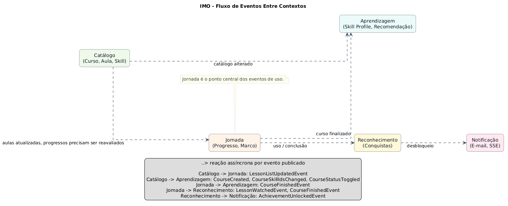
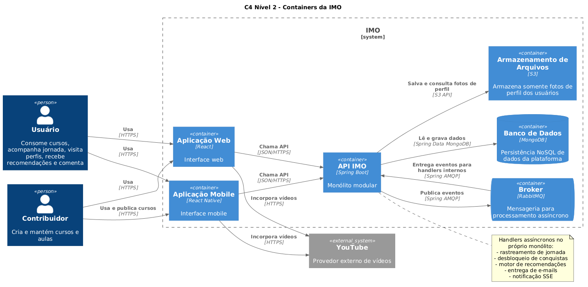

# IMO

Software multiplataforma de aprendizagem que organiza vídeos técnicos do YouTube em cursos com progresso, interação e recomendação.

> **EN summary:** IMO is a multiplatform learning app that curates public YouTube tech videos into ordered courses. It tracks per-lesson progress, awards achievements, builds a skill profile and recommends the next course to close skill gaps. Backend in Java + Spring Boot (modular monolith, RabbitMQ events), web in React + Vite, mobile in React Native + Expo, deployed on AWS with GitHub Actions CI/CD. Academic project at FATEC Diadema.

## Sumário

- [Demonstração](#demonstração)
- [Por que a IMO existe?](#por-que-a-imo-existe)
- [Como funciona na prática](#como-funciona-na-prática)
- [Decisões de engenharia (resumo)](#decisões-de-engenharia-resumo)
- [Como rodar cada ambiente](#como-rodar-cada-ambiente)
- [Domínios da plataforma](#domínios-da-plataforma)
- [Stack principal](#stack-principal)
- [CI/CD e infraestrutura](#cicd-e-infraestrutura)
- [Limitações e próximos passos](#limitações-e-próximos-passos)
- [Arquitetura e documentação complementar](#arquitetura-e-documentação-complementar)
- [Contexto acadêmico](#contexto-acadêmico)

## Demonstração

> 🚧 Vídeo demo em gravação — o player abaixo será ativado após o upload.

<!-- Para ativar: upe o mp4 arrastando em um comentário de Issue/PR pelo github.com e troque o valor de src pela URL gerada (https://github.com/user-attachments/assets/...) -->
<video src="PASTE_GITHUB_VIDEO_URL_HERE" controls width="100%"></video>

Roteiro de 2 min: criar curso a partir de link do YouTube → assistir aula → ver progresso salvar → desbloquear conquista → receber recomendação por skill faltante.

Sem demo pública no momento — para rodar local, siga os guias de cada módulo abaixo.

## Por que a IMO existe?

Aprender programação no YouTube é eficiente, mas frustrante: o conteúdo bom existe, porém está **disperso, sem ordem e sem memória**. Você assiste 10 vídeos soltos, não sabe o que falta aprender e abandona no meio porque ninguém acompanha seu progresso.

A IMO existe para ser **uma camada de curadoria sobre o YouTube**: em vez de hospedar vídeos (caro e com problema de direitos autorais), ela referencia vídeos já públicos e adiciona em cima o que o YouTube não dá para um nicho de estudo — sequência didática, progresso por aula/curso, perfil de skills e recomendação do próximo passo.

## Como funciona na prática

Fluxo central, do curador ao estudante:

1. **Alguém cura:** monta um curso colando links do YouTube em sequência (`web/src/pages/CreateCourse.tsx`). Links em vez de upload = zero custo de armazenamento/transcodificação e zero atrito para criar curso.
2. **Alguém estuda:** assiste na página `Watch`, comenta dúvidas na aula e marca progresso por aula. Progresso granular alimenta conquistas, skills e recomendação.
3. **A plataforma reage:** ao concluir, a jornada emite eventos que atualizam conquistas, skill profile e notificações sem travar a requisição.

Cada recurso existe por um motivo:

- **Cursos em sequência** → playlist solta não garante pré-requisito nem ordem didática.
- **Progresso por aula/curso** → sem memória do que já viu, o estudante repete ou desiste.
- **Comentários na aula** → a hipótese é que dúvida travada no contexto da aula derruba retenção; discutir ali resolve mais rápido que fórum genérico.
- **Perfil público com marcos** → portfólio visível de esforço, não só certificado final.
- **Conquistas (`AchievementPolicies`)** → a hipótese é que gamificação simples aumenta retorno; regra no domínio para valer igual na web e no mobile.
- **Recomendação por gaps (`GapBasedRecommendationEngine` + `WeightedSkillCoverageCalculator`)** → recomendar "populares" não fecha lacuna; recomendar o que falta em skill, sim.
- **Notificações + tempo real (SSE em `useAchievementNotificationStream`)** → reengajam sem deixar o "concluir aula" lento (detalhe de mensageria em `docs/ARCHITECTURE.md`).
- **Web + mobile no mesmo backend stateless** → estudo no PC e no celular sem duplicar regra.

## Decisões de engenharia (resumo)

Time pequeno de projeto integrador, 1 ano, 3 frentes. Foco em **reduzir custo operacional sem perder fronteira de negócio**. Tabela completa em [`docs/ARCHITECTURE.md`](docs/ARCHITECTURE.md).

| Decisão | Por que, em 1 frase |
| :------ | :------------------ |
| Monólito modular por contextos | Fronteira clara sem custo de microsserviços; permite extrair depois. |
| HTTP / usecases / domínio separado | Mesma regra (`CoursePolicies`, `LessonPolicies`) para web e mobile. |
| Eventos assíncronos (RabbitMQ) | "Concluir aula" rápido mesmo se e-mail/recomendação falhar. |
| MongoDB Atlas + índices | Documento flexível, leitura por ID/usuário, tier free para projeto acadêmico. |
| JWT stateless | Um backend para web e mobile, sem sessão no servidor. |
| Testes em 4 camadas + JaCoCo | Unidade, integração com Testcontainers, E2E e UI com Playwright. |
| CI em PR + CD `develop`→homolog, `master`→prod | Demo estável sem "na minha máquina". |
| AWS ECS/ECR + S3/CloudFront + OIDC | Sem gerenciar EC2, front barato, sem secret fixa no repo. |

> Não é DDD formal, mas usa a ideia central: regra explícita no código e contextos com fronteira clara.

## Como rodar cada ambiente

As instruções detalhadas de execução ficam em cada aplicação:

- Backend: [`backend/README.md`](backend/README.md)
- Web: [`web/README.md`](web/README.md)
- Mobile: [`mobile/README.md`](mobile/README.md)

## Domínios da plataforma

Sete contextos porque cada um muda por um motivo diferente:

- `Identidade`: cadastro, login, JWT, recuperação. Muda por segurança.
- `Catálogo`: cursos, aulas, skills. Muda quando o curador edita.
- `Jornada`: progresso e marcos. O mais quente — muda a cada aula assistida.
- `Aprendizagem`: skill profile + recomendação. Reage a Jornada/Catálogo via evento.
- `Social`: comentários e perfil público. Isolado para não poluir Catálogo.
- `Reconhecimento`: conquistas (`AchievementPolicies`). Ouve conclusão de aula/curso.
- `Notificação`: e-mails + SSE. Só reage — se cair, o núcleo continua.

> PNGs em `docs/` são exportados dos `.puml`. Fontes: [`docs/context-events.puml`](docs/context-events.puml), [`docs/context-map.puml`](docs/context-map.puml).

## Stack principal

| Camada | Tecnologias |
| :----- | :---------- |
| Backend | Java 21, Spring Boot, Maven, MongoDB, RabbitMQ, JWT, Spring Security, Spring Mail, Springdoc, Scalar, AWS S3 |
| Web | React 19, TypeScript, Vite, React Router, Tailwind 4, Hook Form, Zod, Axios |
| Mobile | React Native, Expo, Expo Router, NativeWind, Hook Form, Zod |
| Qualidade | JUnit, Mockito, Rest Assured, Testcontainers, JaCoCo, Playwright |
| Infra | Docker, GitHub Actions, AWS ECS, ECR, S3, CloudFront, ALB, IAM, SSM, MongoDB Atlas, CloudAMQP |

Motivos e trade-offs em [`docs/ARCHITECTURE.md`](docs/ARCHITECTURE.md).

## CI/CD e infraestrutura

- Backend: validação em PR (`backend-ci.yml`) + deploy por branch (`backend-cd.yml`): `develop` → homolog, `master` → prod, via Docker → ECR → ECS.
- Web: E2E no CI (`web-ci.yml`) + build → S3 → CloudFront com invalidação (`web-cd.yml`).
- Mobile: **sem CI e sem testes automatizados** — ver [limitações](#limitações-e-próximos-passos).
- Auth AWS via OIDC (sem secret fixa), segredos via SSM/IAM.

## Limitações e próximos passos

O que sabemos que é frágil e ficou fora do escopo do projeto integrador:

- **Vídeo do YouTube removido/privado:** hoje o curso mantém o link e o embed quebra. Falta job de verificação periódica + status `indisponível` + sugestão de reposição.
- **RabbitMQ sem retry/DLQ/idempotência:** filas são duráveis (`RabbitMQConfig.java`), mas sem backoff, sem dead-letter e sem consumidor idempotente. Falha após o commit pode gerar efeito duplicado (e-mail duplo). Escolhemos RabbitMQ em vez de evento interno do Spring porque e-mails precisam sobreviver a restart e o caminho fica aberto para extrair Notificação depois — ao custo de mais infra. Detalhe em `docs/ARCHITECTURE.md §4`.
- **Mobile sem cobertura:** sem workflow de CI e sem testes; validação hoje é manual via Expo. Web tem Playwright, backend tem pirâmide completa.
- **Recomendação simples:** gap de skills ponderado, sem collaborative filtering nem feedback implícito (tempo assistido, abandono).

## Arquitetura e documentação complementar

- Relatório técnico: [PDF](https://drive.google.com/file/d/15P-z4X15PUKV5S0RMsh1uc-ZeS7i92vL/view?usp=sharing)
- Apresentação: [PDF](https://drive.google.com/file/d/1IAsyU9Xxz1II7nAcwYAYRNhJbmf37yGR/view?usp=sharing)
- Decisões detalhadas: [`docs/ARCHITECTURE.md`](docs/ARCHITECTURE.md)
- Context Map: [`docs/context-map.png`](docs/context-map.png) ([fonte `.puml`](docs/context-map.puml))
- Eventos: [`docs/context-events.png`](docs/context-events.png) ([fonte `.puml`](docs/context-events.puml))
- C4: [context](docs/c4/context.png) · [container](docs/c4/container.png) · [component API](docs/c4/component.png) · [component web](docs/c4/component-web.png) ([fontes em `docs/c4/`](docs/c4/))
- Requisitos e regras: [Google Docs](https://docs.google.com/document/d/1ppUHqpMedrUB-X3jCE1EB0Yd62vp4r6L/edit?usp=sharing)
- Histórias e riscos: [Google Sheets](https://docs.google.com/spreadsheets/d/13NYt1LqwIODdfDzTfWS20svd2fkz3Mahpeb3dQzeGY0/edit?usp=sharing)

> PNGs em `docs/` exportados dos `.puml`. Ao alterar um diagrama, regenere o `.png` correspondente e commite os dois.

## Contexto acadêmico

- Instituição: FATEC Diadema
- Curso: Desenvolvimento de Software Multiplataforma
